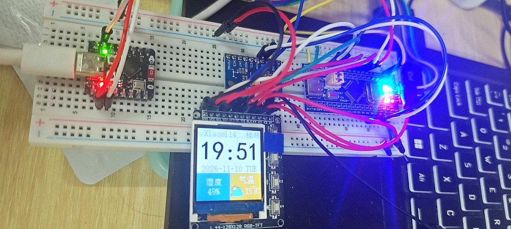
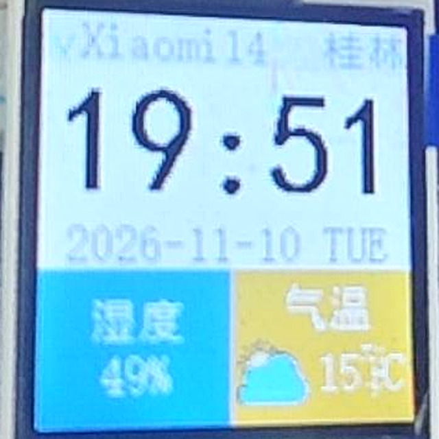
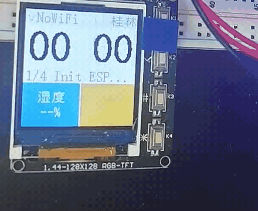
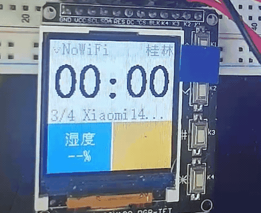

# STM32 智能天气时钟（FreeRTOS 版）

基于 **STM32F103C8T6** 的桌面天气时钟：ESP32-C3（AT 固件）联网获取天气与时间，1.8" ST7735 彩屏显示时钟、气温与湿度，RTC 独立走时，FreeRTOS 多任务调度。

本项目为「裸机版天气时钟」的 FreeRTOS 重构版本，同时也是后续 **OTA 远程升级** 改造的起点。

> **状态：全部功能与多任务架构均已在真机验证通过**（2026-11-10），详见文末「真机验证记录」与「演示：断网 A/B 对比」。



> 实物照片：面包板上的 C8T6、ST7735 彩屏、ESP32-C3 与杜邦线连接。

---

## 功能特性

- **联网天气**：ESP32-C3 通过 AT 指令连接 2.4 GHz WiFi，向心知天气请求实况（天气现象、温度）与当天湿度
- **SNTP 对时**：启动时用 `AT+CIPSNTPTIME?` 取本地时间写入 RTC；RTC 由 LSE 32.768 kHz 晶振走时，掉电保持
- **界面**：128×128 分区布局 —— 状态栏（WiFi 名 + 城市）、48 px 大字号时间、日期行、湿度面板、气温面板
- **湿度**：来自天气 API 的**城市相对湿度**（板上没有湿度传感器），显示如 `49%`
- **气温**：天气 API 实况温度 + 对应的 24×24 天气图标（晴 / 多云 / 阴 / 雨 / 雪 / 风）
- **三任务架构**：`ui_task` / `net_task` / `heartbeat_task` 分工，队列传数据、互斥量保护屏幕、二值信号量做启动闸门
- **断网不冻屏**：AT 指令最长 20 s 的等待被隔离在低优先级网络任务，联网卡住时时间、冒号与 LED 心跳照常
- **栈水位监控**：每 20 s 用 `uxTaskGetStackHighWaterMark()` 采样，低于 64 word 时 LED 快闪告警

> 说明：MPU6050 驱动仍在工程中并完成了初始化，但当前界面不读取它 —— 它的温度是**芯片结温**（比室温高 10 ℃ 以上），不是环境温度，显示出来会误导，因此已停用。姿态自动翻转功能尚未实现。

## 硬件清单

| 器件 | 型号 / 规格 | 说明 |
|---|---|---|
| 主控 | STM32F103C8T6 | 64 KB Flash / 20 KB RAM，72 MHz |
| 显示 | ST7735 1.8" TFT | 128×128，SPI 接口，RGB565 |
| 联网 | ESP32-C3 开发板 | 预烧精简版 AT 固件，UART 115200，自带 Type-C 供电 |
| 姿态 | MPU6050 | 六轴，软件 I2C（当前仅初始化，未使用读数） |
| 走时 | 32.768 kHz 晶振 | 接 PC14 / PC15，供 RTC 使用 |
| 下载 | ST-Link V2 | SWD 四线 |

## 接线表

引脚定义直接取自驱动代码（`driver/` 下各文件的 `#define`），与实际接线一致。

### ST7735 显示屏（SPI1）

| 信号 | 引脚 | 说明 |
|---|---|---|
| SCK | PA5 | SPI1 时钟，18 MHz（72 MHz ÷ 4） |
| MOSI | PA7 | SPI1 数据输出 |
| CS | PA4 | 片选，低有效 |
| DC | PB1 | 命令/数据选择 |
| **RES** | **PB0** | **硬复位，必须接！漏接 = 背光亮但纯白屏** |
| BLK | PB10 | 背光，高电平点亮 |

> SPI1 配置为 Mode 3（CPOL=1, CPHA=2Edge）、单线发送主模式、软件 NSS。屏幕只写不读，因此未占用 MISO（PA6）。
> 像素数据当前使用**阻塞轮询发送**（`ST7735_USE_DMA = 0`），不经过 DMA，避免 DMA 未启动时永久死等。

### ESP32-C3（USART2）

| 信号 | 引脚 | 说明 |
|---|---|---|
| TX | PA2 | STM32 → ESP32 |
| RX | PA3 | ESP32 → STM32 |

> 波特率 115200，中断接收，接收缓冲 4096 B。注意不是 PA9/PA10（那是 USART1）。
> **TX / RX 必须交叉**，且 ESP32 与 STM32 **必须共地**。

### MPU6050（软件 I2C）

| 信号 | 引脚 |
|---|---|
| SCL | PB6 |
| SDA | PB7 |

### 其他

| 器件 | 引脚 |
|---|---|
| 板载 LED | PC13 |
| RTC 晶振 | PC14 / PC15（LSE） |

## 软件架构

```
main()
 ├─ HAL_Init() / SystemClock_Config()       72 MHz（HSE 8 MHz × 9）
 ├─ MX_GPIO_Init() / MX_USART1_UART_Init()
 └─ freertos_start()
      ├─ xQueueCreate(6, weather_msg_t)     网络 → UI 的数据快照队列
      ├─ xSemaphoreCreateMutex()            保护 ST7735（两个任务都要写屏）
      ├─ xSemaphoreCreateBinary()           屏幕就绪闸门，初值 0
      ├─ esp_at_set_wait_hook(net_wait_1ms) 把驱动层 1ms 忙等换成 vTaskDelay(1)
      ├─ xTaskCreate(start_task) / vTaskStartScheduler()    TICK = 1000 Hz
      └─ start_task 建完三个任务后 vTaskDelete(NULL)
           ├─ ui_task         P3  640 word   只画屏 + 500 ms 时间节拍
           ├─ net_task        P2  384 word   WiFi / SNTP / HTTP，只发队列
           └─ heartbeat_task  P4  128 word   1 Hz LED + 20 s 栈水位采样
```

启动顺序（**顺序和闸门都很重要**）：

```
ui_task:   led_init → st7735_init → rtc_init → mpu6050_init
        → 画静态框架 / 状态栏 / 日期 / 时间 / 湿度面板
        → xSemaphoreGive(g_lcd_ready)          放行 net_task
        → 循环：非阻塞 xQueueReceive + 每 500 ms 刷时间/冒号

net_task:  xSemaphoreTake(g_lcd_ready)         屏没初始化好之前绝不碰屏
        → net_init_network()（进度行，写屏前先拿 g_lcd_mutex）
        → 依次发 MSG_WIFI_STATUS / MSG_NET_DONE / MSG_WEATHER / MSG_HUMIDITY
        → 循环：每 10 min 刷天气 + 对时，每 60 min 刷湿度
```

| 同步对象 | 类型 | 解决的问题 |
|---|---|---|
| `g_weather_q` | 队列（深度 6） | 网络数据与界面解耦；UI 用 `xQueueReceive(..., 0)` 非阻塞取，绝不因等网络而停摆 |
| `g_lcd_mutex` | 互斥量 | `net_task` 画开机进度、`ui_task` 画主界面共用 SPI，避免半帧交错 |
| `g_lcd_ready` | 二值信号量 | ESP32 串口在联网流程里才初始化，闸门保证进度行不会写进一块还没初始化的屏 |

**为什么做这次拆分（真实缺陷，不是为了用 RTOS 而用）**：`esp_at_send_command()` 的等待是 `while (rxready && timeout--) delay_ms(1)`，`AT+CWJAP` 上限 20 s、HTTP 10 s。原架构网络与画屏挤在同一个 `ui_task` 里，请求一卡就整屏冻结、时间不跳、LED 不闪。

**驱动层保持零 RTOS 依赖**：`esp_at.c` 不 include 任何 RTOS 头文件，只暴露一个 `esp_at_set_wait_hook()` 函数指针；任务层注册 `net_wait_1ms()`（`vTaskDelay(1)`），把每 1 ms 的忙等变成挂起一个 tick。系统 tick 是 1 kHz，任务总在 tick 边界被唤醒，超时仍按毫秒计。固定延时（500 / 2500 / 1000 ms）也走同一路径。

> **踩过的坑：低优先级饥饿。** 首版把 `heartbeat_task` 放在 P1（最低），真机出现「冒号照常闪、PC13 LED 完全不闪」——因为 `net_task`(P2) 忙等时始终就绪，`ui_task`(P3) 能抢占，而 P1 一次都调度不到。修复是三管齐下：等待钩子让出 CPU、心跳提到 P4（存活指示器必须独立于业务负载）、并给三个 `xTaskCreate` 补返回值检查（堆不足时以 100 ms 快闪报警，不再静默失败）。

任务参数：优先级 5 级（`configMAX_PRIORITIES = 5`）、最小栈 128 word、堆 8 KB（`heap_4`，三个任务栈与同步对象均从中动态分配）、`configUSE_MUTEXES = 1`、`INCLUDE_uxTaskGetStackHighWaterMark = 1`。

> 曾经的顺序 bug：`ui_update_weather()` 排在串口初始化之前，等于把 AT 命令发给一个还没打开的串口，会白等 10 秒，表现为「橙色面板空白」。现在已修正，并由 `g_lcd_ready` 从机制上杜绝。

## 目录结构

```
weather_clock/
├── Core/                    CubeMX 生成的应用与 HAL 配置
│   ├── Inc/                 main.h / FreeRTOSConfig.h / HAL 配置
│   └── Src/                 main.c / gpio.c / usart.c / stm32f1xx_it.c
├── Drivers/                 STM32F1 HAL 库 + CMSIS（ST 官方，未改动）
├── FreeRTOS/                内核源码（tasks / queue / list）+ heap_4 + ARM_CM3 port
├── docs/                    实物照片 + 断网 A/B 对比演示 GIF
│   ├── hardware.jpg / screen.jpg
│   └── demo-offline.gif / demo-online.gif
└── mdk/                     Keil MDK 工程
    ├── Freertos的嵌入式智能天气时钟.uvprojx
    ├── app/                 应用层：天气解析、字库、开机动画、图标
    ├── driver/              外设驱动：st7735 / esp-at / mpu6050 / led / rtc
    └── user/                任务实现 freertos_demo.c、本地配置 wifi_config.h
```

工程文件使用 `..\Core`、`..\Drivers`、`..\FreeRTOS` 相对路径引用上层目录，因此**必须保持上述目录结构**，不可只复制 `mdk/`。

## 编译与烧录

1. **配置本地参数**：编辑 `mdk/user/wifi_config.h`，填入自己的 WiFi 账号与心知天气 API key：

   ```c
   #define WIFI_CFG_SSID        "你的WiFi名"          /* 必须 2.4 GHz */
   #define WIFI_CFG_PWD         "你的WiFi密码"
   #define WEATHER_CFG_API_KEY  "你的心知天气key"      /* seniverse.com 免费注册 */
   #define WEATHER_CFG_CITY     "guilin"
   ```

   > 仓库中该文件是占位符版本（`YOUR_WIFI_SSID` 等），不填无法联网，但能正常编译。照片与录屏里的 SSID 是实机调试用的真实热点名，配置文件本身不含任何真实凭据。

2. **打开工程**：Keil MDK 打开 `mdk/Freertos的嵌入式智能天气时钟.uvprojx`
3. **编译烧录**：`F7` 编译 → `F8` 下载（ST-Link，起始地址 `0x08000000`，BOOT0 接 GND）
4. **上电观察**：LED 慢闪 3 次（启动标志）→ 屏幕出完整界面，中间提示行依次走 `1/4 Init ESP...` → `2/4 STA Mode...` → `3/4 <SSID>...` → `4/4 SNTP Sync...` → 进入时钟界面，LED 转为稳定 1 Hz 慢闪

### 排障提示（都是真机踩过的坑）

| 现象 | 原因与排查方向 |
|---|---|
| **背光亮、屏幕纯白** | **头号原因：RES 没接 PB0**，或 RES/DC 接反（PB0 与 PB1 是相邻两孔）。屏没被硬件复位唤醒，发什么命令都不响应 |
| 背光亮、有画面但卡住 | 检查 `net_init_network()` 顺序，AT 命令不能发在串口初始化之前 |
| 屏幕全黑 | 量 PB10 背光是否为高、VCC 是否 3.3 V |
| 顶部彩条都画不出来 | 用 `st7735_probe_bars()` 做最小路径测试（绕过上层绘图）；能出彩条 = 屏与 SPI 正常，问题在绘图层 |
| `ESP rx=0000` | ESP32 一个字节都没回：查 TX/RX 交叉、共地、EN/BOOT 脚、供电（不要用 ST-Link 的 3.3 V 带 ESP） |
| 时间显示 `08:xx` | `AT+SYSTIMESTAMP?` 不被固件支持导致时间戳为 0（1970+8h）。本工程已改用 `AT+CIPSNTPTIME?` |
| 图标是黑底 + 颜色错乱 | RGB565 图标数组是**小端**存放，且 `0x0000` 表示透明。本工程已按小端解析并跳过纯黑 |
| 湿度显示 `--%` | 湿度来自 `daily.json`，联网失败或接口未返回时会保持占位符，属正常容错 |
| 冒号闪但 LED 完全不闪 | 低优先级饥饿：`net_task` 长忙等期间心跳任务抢不到 CPU。本工程已用等待钩子 + 心跳 P4 修复 |
| LED 上电后 100 ms 快闪不停 | `ucHeap` 不足导致某个 `xTaskCreate` 失败，需扩堆或缩任务栈 |

> **AT 固件差异**：实测这颗 ESP32-C3 是裁剪版乐鑫 AT 固件，支持 `AT` / `CWMODE` / `CWJAP` / `CIPSNTPCFG` / `CIPSNTPTIME?` / `HTTPCGET`，但不支持 `AT+GMR` / `AT+VER` / `AT+CIPSTA?` / `AT+SYSTIMESTAMP?`。因此初始化采用「先用 `AT` 探活，其余尽力而为」的容错写法，不因某条可选命令报错就判定模组失联。

## 资源占用（实测，Keil V5.06 编译结果）

```
Program Size: Code=15928  RO-data=32052  RW-data=252  ZI-data=17684
```

| 项目 | 占用 | 总容量 | 使用率 |
|---|---|---|---|
| Flash（Code + RO + RW） | 48 232 B ≈ **47.1 KB** | 64 KB | 73.6% |
| RAM（RW + ZI） | 17 936 B ≈ **17.5 KB** | 20 KB | 87.6% |

> 多任务重构相比单任务版 Flash +2 916 B（三任务 TCB/栈从 8 KB `ucHeap` 动态分配，不增加静态 ZI）、RAM +32 B。数值含本地 WiFi 账号字符串，换用不同长度的 SSID 会有几十字节偏差。

**空间分析（决定了后续改造路线）**

- `RO-data` 中 **27 648 B（27 KB）是 6 张天气图标**（48×48 RGB565），占 Flash 的 57%，占 RO-data 的 86%。若迁移到外部 SPI Flash，Flash 占用可降到约 20 KB。
- RAM 仅剩 **2.5 KB**。若直接移植 OTA BootLoader 并与 APP 共享缓冲区，极易栈溢出，需重新核算任务栈与堆。
- 若套用 16 KB Boot + 47 KB APP 的 OTA 分区，APP 可用 48 128 B，而当前已占 48 232 B —— **超出 104 B**。所以**图标外置 W25Q 已从「建议」变成移植 OTA 的硬前置条件**。

## 真机验证记录（2026-11-10）

在 STM32F103C8T6 + ST7735 + ESP32-C3 实物上完成，屏幕实测显示：



```
状态栏   Xiaomi14 | 桂林    ← WiFi 已连接
时间     19:51                ← 与北京时间一致，SNTP 对时正确
日期     2026-11-10 TUE
湿度     49%                  ← 心知 daily.json 返回
气温     15°C + 多云图标       ← 心知 now.json 返回，图标颜色/透明正常
```

已验证：SPI 显示链路、RGB565 字序、16×16 中文字模、窗口坐标、RTC 走时、USART2 中断接收、AT 指令建链、WiFi 入网、SNTP 对时、HTTP 取天气与湿度、FreeRTOS 三任务调度、队列/互斥量/信号量、`uxTaskGetStackHighWaterMark` 栈水位采样、LED 心跳。

**多任务专项验证**（关掉手机热点后按 RESET）：

| 观察项 | 结果 |
|---|---|
| LED 慢闪 3 次（启动标志）→ 稳定 1 Hz 慢闪 | 通过 |
| 联网卡住的几十秒内，中间冒号持续每秒闪一次 | 通过 |
| 同一时间窗内 PC13 LED 保持 1 Hz 慢闪、屏幕不冻结 | 通过 |
| 恢复热点后重启，天气 / 湿度 / 对时回来 | 通过 |
| 栈水位告警（快闪 3 次） | 未触发 |

排查过程中定位并修复的问题（均已在代码中）：

| # | 问题 | 修复 |
|---|---|---|
| 1 | RES 未接导致白屏 | 接线修正；驱动本来就有 `st7735_reset()` 硬件复位时序 |
| 2 | `rtc_init()` 裸等 LSE 无超时，晶振不起振即死机 | 加 2.3 s 超时并降级 LSI；`rtc_wait_for_rtoff()` 同样加超时 |
| 3 | `st7735_write_data()` 等 DMA TCIF 无超时 | 加超时兜底 + 默认切到阻塞写 |
| 4 | `ui_update_weather()` 早于串口初始化 | 调整顺序，先联网再取天气/湿度 |
| 5 | `AT+SYSTIMESTAMP?` 不被支持 → 时间变成 1970 | 改用 `AT+CIPSNTPTIME?` 解析，且不再重复 +8 h |
| 6 | 联网进度行擦掉日期行 | 联网结束后补画一次日期 |
| 7 | 湿度行超出 64 px 面板 4 px，蓝色侵入橙色面板 | 重排文字起点，收进面板边界 |
| 8 | 图标字节序错（大端→小端）+ 黑底 | 小端解析 + `0x0000` 视为透明 |
| 9 | 湿度无数据来源 | 新增 `daily.json` 请求与 `weather_parse_humidity()` |
| 10 | 网络请求卡住时整屏冻结 10 s | 拆出 P2 `net_task` + 队列解耦，UI 独立 500 ms 节拍 |
| 11 | 多任务首版「冒号闪但 LED 不闪」 | 低优先级饥饿：`esp_at` 等待钩子让出 CPU + 心跳提到 P4 |
| 12 | `xTaskCreate` 返回值被丢弃，堆不足时静默失败 | 逐个检查返回值，失败以 100 ms 快闪报警 |

## 演示：断网 A/B 对比

两段真机录屏取自**同一起点**（按 RESET 重启，RTC 无备份电池故从 `00:00` 起），已转正、裁到屏幕区域并转成 6 fps 优化 GIF（单文件均小于 GitHub 10 MB 上限）：

| 关掉手机热点 | 打开手机热点 |
|---|---|
|  |  |
| 状态栏 `NoWiFi`，停在 `3/4 Xiaomi14...`，时间保持 `00:00` | `3/4` → SNTP 对时跳到 `21:02` → `21:03`，气温 `14°C` 与云图标刷出 |
| **冒号持续闪、屏幕不冻、LED 保持 1 Hz**：网络忙等被隔离在 P2，UI(P3) 与心跳(P4) 照常抢占 | 数据回来后只重画对应面板，时间节拍不受影响 |

> 断网那次湿度保持 `--%`、气温面板留空，是刻意的容错行为：请求失败时保留占位符，不覆盖旧值、不阻塞界面。湿度需单独请求 `daily.json`，本次演示未取到；上面那张静态特写里显示为 `49%`。
>
> 两段 GIF 循环播放，单文件 2.96 MB / 4.61 MB；原始 mp4 未在仓库中重复存放。

## 当前进度与后续计划

- [x] 裸机版 → FreeRTOS 重构，Keil 编译 0 Error / 0 Warning
- [x] 全部功能真机验证通过（显示 / 对时 / 联网 / 天气 / 湿度）
- [x] **多任务重构**：`ui_task` / `net_task` / `heartbeat_task` + 队列 / 互斥量 / 二值信号量 / 栈水位监控，真机验证通过
- [ ] 图标外置到 W25Q（释放 27 KB Flash，为 OTA 腾出空间 —— 当前已超 APP 分区 104 B，属硬前置）
- [ ] 移植 OTA BootLoader（`0x08000000` 16 KB Boot + `0x08004000` APP）

## 说明

- `mdk/user/wifi_config.h` 在仓库中为占位符版本。本地填入真实值后，建议执行
  `git update-index --skip-worktree mdk/user/wifi_config.h` 避免敏感信息被提交。
- `Drivers/` 与 `FreeRTOS/` 为 ST 官方与 FreeRTOS 官方源码，未做修改。
